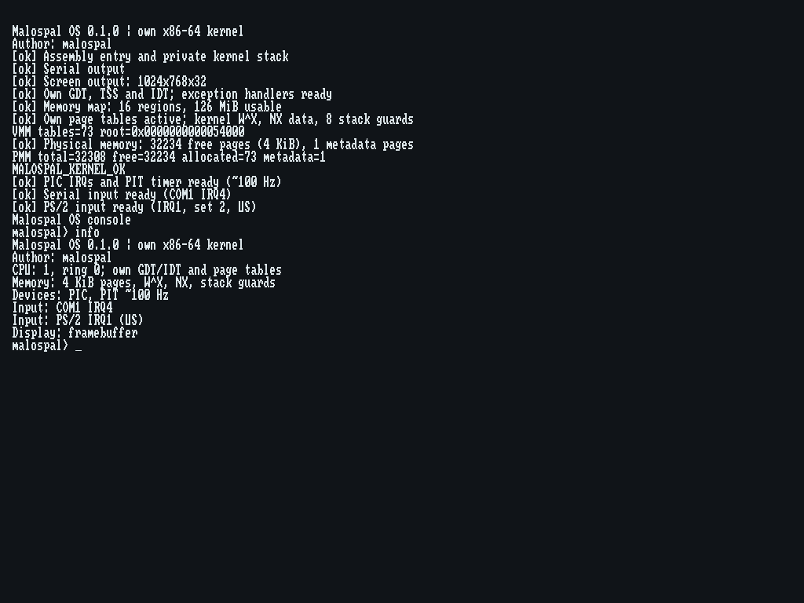
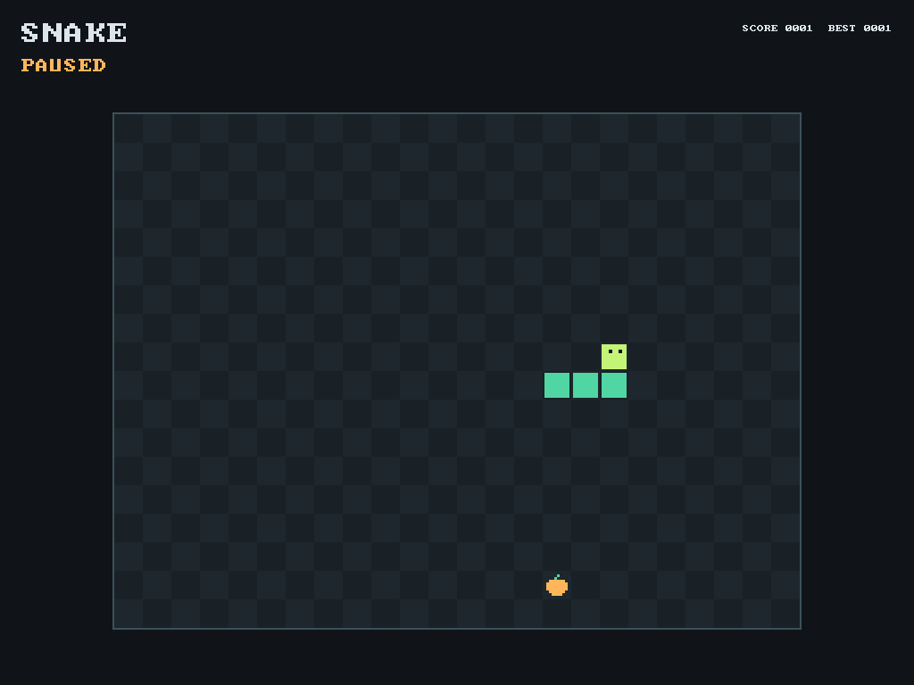
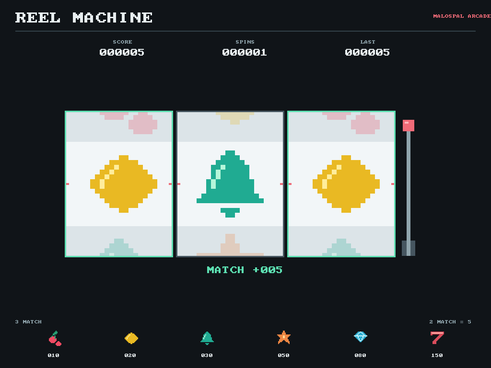

# Malospal OS

Моя учебная операционная система для **x86-64** на C17 и ассемблере.
Автор — **malospal** ([malospa1](https://github.com/malospa1)).

Я развиваю собственное ядро: загрузку, память, прерывания, драйверы и консоль.
Для загрузки использую Limine. Текущая версия — **0.1.0**.



## Что работает

- Загрузка через BIOS и UEFI, обработка исключений.
- Распределение страниц памяти по 4 КиБ, собственные таблицы страниц,
  защита кода от записи, NX и защитные страницы стеков.
- Прерывания PIC, таймер PIT, вывод на экран и COM1.
- PS/2-клавиатура и USB boot-HID клавиатура через xHCI.
- Командная консоль и две игры: Snake и Slots.

Процессы, файловая система, мышь и оконный интерфейс пока не реализованы.
USB-драйвер поддерживает ограниченный набор клавиатур; подробности —
в [описании USB](docs/usb-keyboard.md).

## Игры

| Snake | Slots |
| --- | --- |
|  |  |
| Запуск: `snake`. [Управление](docs/game.md) | Запуск: `slots`. [Управление](docs/slots.md) |

## Как запустить

В [выпуске v0.1.0](https://github.com/malospa1/Malospal-OS/releases/tag/v0.1.0)
есть готовый ISO, архив файлов для UEFI-флешки и контрольные суммы SHA-256.

Для VirtualBox создай машину Other/Unknown (64-bit), выдели 128 МиБ памяти
и один процессор, включи PAE/NX и подключи `malospal-os-0.1.0.iso` как CD/DVD.
Для первого запуска можно оставить BIOS. Команды вводятся в окне машины,
раскладка — английская US.

После загрузки появится `malospal>`. Начни с `help` или `info`.

| Команда | Действие |
| --- | --- |
| `help` | Список команд |
| `info` | Версия, автор и устройства |
| `mem` | Состояние памяти |
| `ticks` | Счётчик таймера |
| `serial`, `keyboard` | Статистика ввода |
| `echo hello` | Вывод текста |
| `snake`, `slots` | Запуск игр; Esc возвращает в консоль |
| `halt` | Остановка ядра |

Комплект `malospal-os-0.1.0-uefi-usb.zip` предназначен для существующей
загрузочной FAT32-флешки: содержимое архива копируется в её корень.
Он рассчитан на UEFI x86-64 с отключённым Secure Boot.
ISO предназначен для CD/DVD или виртуальной машины.
[Подробная инструкция для USB](docs/usb-keyboard.md).

## Сборка из исходников

Нужны Git, Python 3.9+, Zig 0.15.2 и QEMU для запуска и проверок.
Выполни из папки репозитория:

```powershell
python -m pip install -r kernel/requirements.txt
python kernel/tools/build.py build
python kernel/tools/build.py run
```

В Windows после установки инструментов можно запускать `run-kernel.cmd`
двойным щелчком. Сборка создаёт `kernel/build/normal/malospal-os.iso` и
папку `kernel/build/normal/usb-uefi/`.

Полная проверка:

```powershell
python kernel/tools/build.py check
```

Сценарий проверяет 30 групп тестов на основной системе и выполняет
63 запуска QEMU: BIOS/UEFI, память, исключения, консоль, экран, клавиатуры и игры.
[Настройка инструментов](kernel/README.md), [результат проверки выпуска](docs/testing.md).

## Структура

| Папка | Содержимое |
| --- | --- |
| `kernel/src/` | Ядро, драйверы и игры |
| `kernel/include/` | Заголовки ядра |
| `kernel/tests/`, `kernel/tools/` | Проверки и сборка |
| `kernel/vendor/` | Сторонний код с исходными сведениями об авторах |
| `docs/` | Описание устройства системы |
| `legacy/buildroot/` | Мой прежний прототип на Linux и Buildroot |

[Архитектура](docs/architecture.md) · [Память](docs/physical-memory.md) ·
[Виртуальная память](docs/virtual-memory.md) · [Консоль](docs/console.md) ·
[Snake](docs/game.md) · [Slots](docs/slots.md).

Сведения об авторе находятся в [AUTHORS.md](AUTHORS.md), сведения о сторонних
компонентах и их лицензиях — в [THIRD_PARTY.md](THIRD_PARTY.md).
