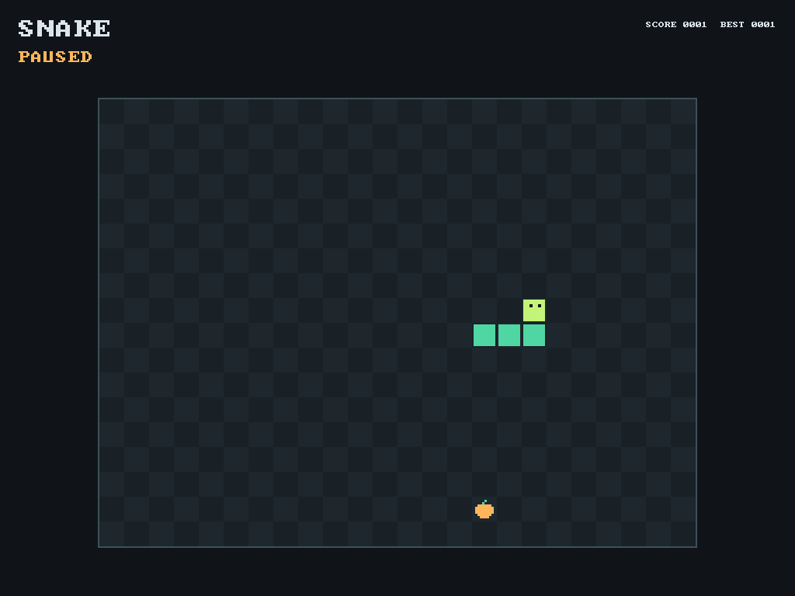

# Змейка в Malospal OS



В консоли набери `snake` и нажми Enter. Игра откроется на экране виртуальной
машины и будет ждать начала. В VirtualBox щёлкни внутри окна, чтобы захватить
клавиатуру; поддерживаются PS/2 и USB boot-HID через xHCI.

| Клавиша | Действие |
| --- | --- |
| Пробел или Enter | Начать игру, поставить на паузу или продолжить |
| Стрелки или WASD | Направление движения; из READY также начинают игру |
| P | Пауза / продолжение |
| R | Новая партия, снова в состоянии READY |
| Esc или Q | Вернуться в консоль |

Собирай оранжевую еду: каждое очко увеличивает длину. Через край поля змейка
появляется с противоположной стороны. Столкновение с собой заканчивает партию;
разворот на 180 градусов запрещён. При заполнении всех 24x18 клеток появляется
`YOU WIN`. Каждые три очка скорость немного растёт, от шага за 18 тиков до 8.
Тики номинально идут с частотой 100 Гц, но это не точные часы реального времени.

`BEST` сохраняется между партиями и запусками команды до перезагрузки Malospal OS.
Сохранения на диск нет. Работают заглавные и строчные WASD/R/P/Q; буквенная
раскладка пока US. Через COM1 доступны буквенные клавиши и пробел; стрелки
терминала не поддерживаются, поскольку Escape используется для выхода.

После выхода восстанавливается прежний текстовый экран, снова можно вводить
`help`, `info`, `mem` и остальные команды. При отсутствии экрана или разрешении
меньше 320x240 команда сообщает об ограничении и возвращается в консоль.
COM1 не обязателен: игра работает с экраном и PS/2 либо USB. [USB и ноутбуки](usb-keyboard.md).

## Устройство

Это пока встроенная игра в ring 0, а не отдельный пользовательский процесс.
Пока она открыта, основной цикл консоли занят игрой, но IRQ таймера и ввода
продолжают работать. Между проверками ввода CPU ждёт через `hlt`; игра не
выделяет страницы или память из кучи. После потери ввода партия ставится на
паузу; при отказе обоих устройств происходит выход в консоль.

- `kernel/src/games/snake_logic.c`: состояние и шаг игры без драйверов.
- `kernel/src/games/snake.c`: клавиши, таймер, счёт, состояния и отрисовка.
- `kernel/src/video/screen.c`: ограниченные границами framebuffer прямоугольники,
  растровый текст и восстановление консоли после графического режима.
- `keyboard_read_key()` возвращает ASCII и стрелки; прежний `keyboard_read()`
  фильтрует стрелки, поэтому поведение текстового редактора не изменилось.

Игровая логика адаптирована из [публичного примера SDL Snake](https://github.com/libsdl-org/SDL/blob/96292a5b464258a2b926e0a3d72f8b98c2a81aa6/examples/demo/01-snake/snake.c),
помеченного Public Domain. Используются его направление в каждой клетке,
упакованное поле и обход головы/хвоста. Сама SDL, Linux и Windows API в госте
не используются. Исходная версия, атрибуция и список адаптаций находятся в
`kernel/vendor/sdl-snake/`. Это сторонняя игровая логика, не замена ядра.
Спрайт еды добавлен для Malospal OS, шрифт остаётся Public Domain font8x8.

## Проверки

```powershell
powershell -NoProfile -ExecutionPolicy Bypass -File .\kernel\build.ps1 game
powershell -NoProfile -ExecutionPolicy Bypass -File .\kernel\build.ps1 game -Uefi -Memory 256
powershell -NoProfile -ExecutionPolicy Bypass -File .\kernel\build.ps1 check
```

`game` проверяет обычный образ и работу без COM1. События клавиатуры поступают
через QMP в настоящий PS/2-драйвер, изображение проверяется по пикселям:
появление поля, движение и рост, поворот, неподвижная пауза, перезапуск,
возврат в консоль, повторный запуск через COM1 и отсутствие утечки страниц.
Локальный тест проверяет 100000 шагов, разворот, края, рост, столкновение,
вход в освобождаемую клетку хвоста, последнюю свободную клетку и победу.
Тесты экрана RGB24/RGB32 проверяют обрезку рисования, защитные байты и
восстановление текста; специальные команды тестирования в игру не добавлены.

Полный набор содержит 30 локальных групп и 63 запуска QEMU, включая четыре
сценария игры: BIOS/128 МиБ, UEFI/256 МиБ, без COM1 и без видеоустройства.
Текущий общий журнал: `kernel/build/check-usb.log`; снимки Змейки:
`kernel/build/normal/game-*.png`. Отдельная команда `slots` открывает
[слот-машину](slots.md), не заменяя Змейку.
Отдельно в VirtualBox 7.2.16 BIOS проверены запуск, первое очко, рост, поворот
стрелкой, пауза и выполнение `info` после выхода. Снимок:
`kernel/build/normal/game-virtualbox.png`. Реальный компьютер пока не проверен.
