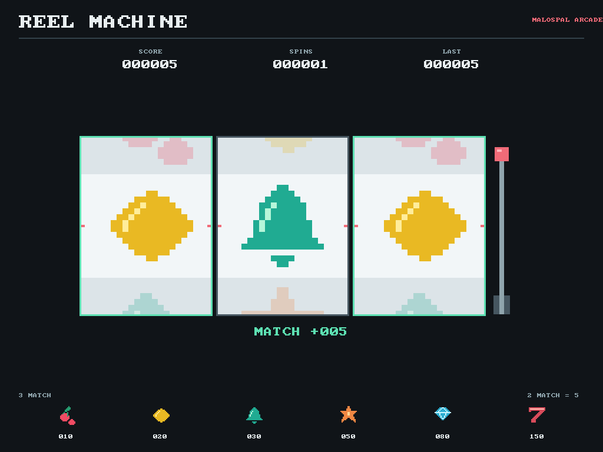

# Reel Machine



Слот-машина как мини-игра внутри Malospal OS: три барабана, шесть символов и очки за
совпадения. Все вращения бесплатные и неограниченные. Очки ничего не покупают
и никуда не переводятся; ставок, платежей и внешних сервисов нет.

В приглашении `malospal> ` набери `slots` и нажми Enter. В VirtualBox щёлкни
внутри окна машины для захвата клавиатуры. Автомат ждёт следующего нажатия.

| Клавиша | Действие |
| --- | --- |
| Пробел или Enter | Вращать барабаны |
| R | Обнулить очки и число вращений, когда барабаны остановлены |
| Esc или Q | Вернуться в консоль |

Работают PS/2, USB boot-HID через xHCI и те же клавиши через COM1. Результаты сохраняются между вызовами
`slots` до перезагрузки Malospal OS или нажатия R. Пробел и R во время вращения
игнорируются: нового вращения поверх текущего не будет. Если выйти до остановки,
уже выбранный результат засчитывается один раз и остаётся при следующем запуске.

## Очки

Учитывается только центральная строка. Любая пара одинаковых символов даёт
5 очков; три одинаковых дают значение из таблицы, без добавления очков за пару.
Если все три разные, очки не меняются.

| Три одинаковых | Очки |
| --- | --- |
| Вишни | 10 |
| Лимоны | 20 |
| Колокольчики | 30 |
| Звёзды | 50 |
| Кристаллы | 80 |
| Семёрки | 150 |

На экране `SCORE` показывает общий счёт, `SPINS` число вращений, `LAST` очки за
последнее вращение. Совпавшие барабаны подсвечиваются. Счёт и счётчики ограничены
999999, переполнения с возвратом к нулю нет. Рычаг и символы анимированы;
драйвера мыши пока нет, управление клавиатурное.

## Внутреннее устройство

Игра работает в ring 0 в основном потоке, не из обработчиков IRQ. Это ещё не
отдельный пользовательский процесс. Нет динамического выделения памяти, сети
или записи на диск. После выхода восстанавливается текстовый экран консоли.
Нужен framebuffer не меньше 640x480; без него команда сообщает об ограничении.
Без COM1 игра работает с PS/2 либо USB и экраном. При потере входных байтов очередь
очищается, текущее вращение завершается; при отказе обоих устройств игра выходит.

- `kernel/src/games/slots_logic.c`: результаты, очки, состояние вращения.
- `kernel/src/games/slots.c`: графика, рычаг, клавиши и журнал.
- `kernel/src/games/slots_sprites.h`: оригинальные двухцветные спрайты 16x16.
- `kernel/src/games/game_input.c`: общий ввод и ожидание тика для обеих игр.

Каждый из шести символов выбирается независимо с равной вероятностью.
Используется минимальная C-библиотека [PCG](https://www.pcg-random.org/using-pcg-c-basic.html),
закреплённая в `kernel/vendor/pcg/`; Apache-2.0, лицензия включена в ISO.
Начальное состояние зависит от тиков запуска. Это псевдослучайность, а не
криптографический генератор и не источник аппаратной энтропии.

Тройка результатов выбирается при старте, а анимация её не меняет. Барабаны
останавливаются на 70-м, 110-м и 150-м доставленном тике PIT, номинально за
1,5 секунды. Изменение скорости эмулятора влияет на длительность, но не на
правила начисления очков. Повторное завершение одного вращения ничего не добавляет.

## Проверки

```powershell
powershell -NoProfile -ExecutionPolicy Bypass -File .\kernel\build.ps1 slots
powershell -NoProfile -ExecutionPolicy Bypass -File .\kernel\build.ps1 slots -Uefi -Memory 256
powershell -NoProfile -ExecutionPolicy Bypass -File .\kernel\build.ps1 check
```

Локальный тест сверяет известную последовательность PCG, все 216 комбинаций,
поочерёдную остановку, защиту от повторного запуска и начисления, переполнение
таймера, предельные счётчики и 100000 вращений. QEMU проверяет настоящие пиксели,
движение, неподвижность остановленных барабанов, совпадение счёта с результатом,
сброс, выход во время вращения, повторный запуск, отсутствие утечки страниц,
работу без COM1 и отказ без экрана. Тестовых обходов правил в ядре нет.

Полный набор: 30 локальных групп и 63 запуска QEMU, включая четыре проверки
слотов (BIOS/128 МиБ, UEFI/256 МиБ, без COM1 и без видеоустройства).
Журнал: `kernel/build/check-usb.log`; снимки: `kernel/build/normal/slots-*.png`.
2026-10-19 в VirtualBox 7.2.16 (BIOS, 1 CPU, 1024 МиБ, VBoxVGA) также проверены
запуск, вращение, остановка и команда `info` после выхода. Снимок:
`kernel/build/normal/slots-virtualbox.png`.
На физическом компьютере пока не проверено.
